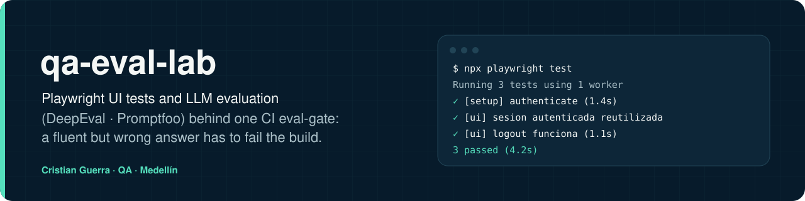
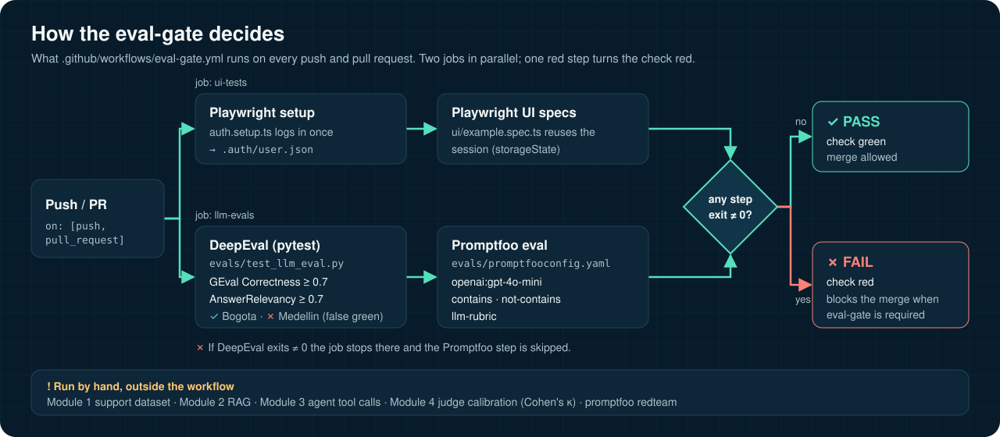
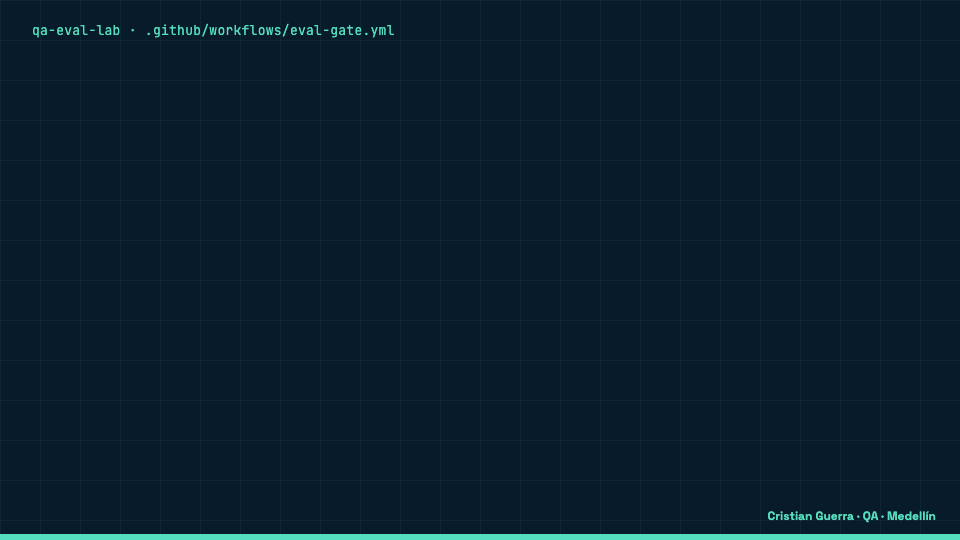
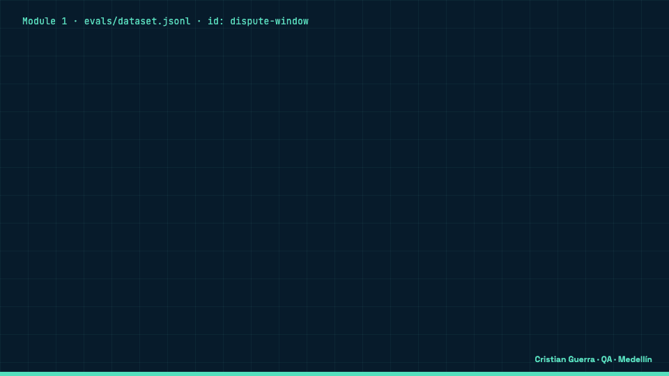
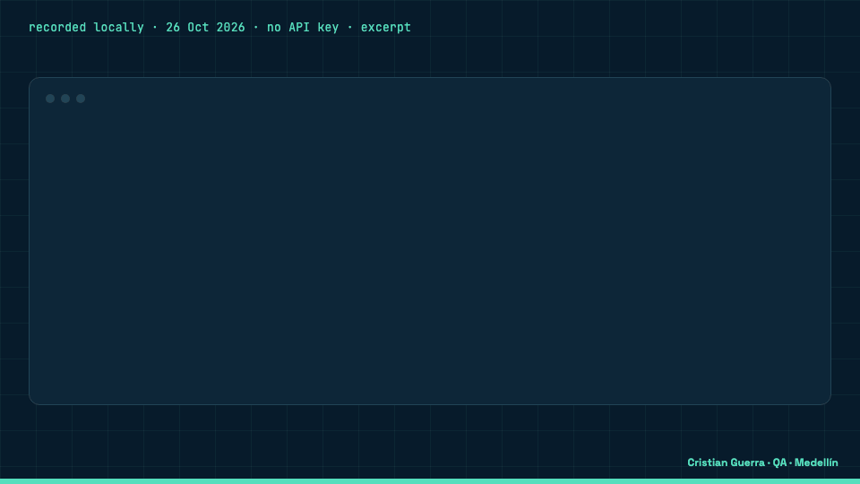

[Leer en español](README.es.md)



<p>
  
  
  
  
  
  
  
</p>

Most test suites verify **deterministic** software. AI features are different: an answer can be well-formed and still **wrong**, a **"false green"** that a `status == 200` or "field exists" assertion lets through. `qa-eval-lab` puts Playwright UI tests and LLM evaluation (DeepEval + Promptfoo) behind one CI **eval-gate**, so a model or prompt change that starts making things up fails the pipeline before it reaches a user.

> Reference project for the move **QA Automation → AI-Evaluation Engineer**: traditional QA discipline (coverage, regression gates, failure-mode thinking) applied to non-deterministic LLM systems.

## How it works



`.github/workflows/eval-gate.yml` runs two jobs on every push and pull request:

- **ui-tests**: `auth.setup.ts` logs in once and saves the session to `.auth/user.json` (`storageState`); the specs in `tests/ui/` reuse it.
- **llm-evals**: `deepeval test run test_llm_eval.py` scores answers with `GEval` (LLM-as-judge) and `AnswerRelevancy`, both with threshold `0.7`; then `promptfoo eval` checks `contains`, `not-contains` and `llm-rubric` against `openai:gpt-4o-mini`.

Any step that exits non-zero turns the check red. If DeepEval fails, the job stops there and the Promptfoo step is skipped.



The animation uses the two cases in `evals/test_llm_eval.py`. The verdicts are the ones the cases are designed to get; I did not run the judge for it because it needs `OPENAI_API_KEY`.

## The "false green" in action

`evals/dataset.jsonl` powers `evals/test_support_eval.py` (a fintech support assistant). **Two rows carry answers that are well-formed but factually wrong** on purpose:

| Case | Question | Wrong answer under test | Why the judge must fail it |
|---|---|---|---|
| `dispute-window` | Dispute a 90-day-old charge? | "Yes, any charge, no time limit." | Ignores the ~60-day window. |
| `card-blocked` | Card blocked after 3 wrong PINs | "Permanently cancelled, unrecoverable." | Invents an irreversible outcome. |

A naive assertion passes them (they *look* right). The **LLM-as-judge fails them**, and that is the false green the gate is built to catch.



Case text and threshold are the real ones from the repo; the verdicts are the designed ones (this README and the test docstring), not a recorded judge run.

## Run it

**Prerequisites:** Node 18+, Python 3.10+, and an `OPENAI_API_KEY` (or another provider) for the LLM-as-judge.

```bash
# 1) Clone
git clone https://github.com/criguex/qa-eval-lab.git && cd qa-eval-lab

# 2) UI tests (Playwright)
npm install
npx playwright install chromium
npm run test:ui
#   real apps: do the login yourself once, session is saved
MANUAL_LOGIN=1 npx playwright test --project=setup --headed

# 3) LLM evals (need OPENAI_API_KEY)
export OPENAI_API_KEY=sk-...
pip install -r evals/requirements.txt
deepeval test run evals/test_support_eval.py     # realistic dataset (Module 1)
npm run eval:promptfoo                            # model compare + rubric
npx promptfoo@latest redteam run                  # security / red-team

# 4) Judge calibration (offline)
python evals/calibration/calibrate_judge.py
```

## What's inside

| Layer | Tool | What it does |
|---|---|---|
| **UI / E2E** | Playwright + TypeScript | Flows against `https://the-internet.herokuapp.com` (or `BASE_URL`) with the real **auth pattern** (`storageState`): log in once, reuse the session in every test. |
| **Model evals** | DeepEval (pytest-native) | `GEval` (LLM-as-judge), `AnswerRelevancy`, faithfulness and tool-call checks over datasets. |
| **Prompt / security** | Promptfoo | Model comparison, `llm-rubric` assertions, and **red-teaming** (plugins `pii`, `harmful:misinformation`; strategies `prompt-injection`, `jailbreak`). |
| **Gate** | GitHub Actions | Runs UI + evals on every push/PR and **fails when a score drops below its threshold**. |

### How verdicts are made

| Metric | Question it answers | Threshold |
|---|---|---|
| `GEval` (Correctness) | Is the answer factually right vs the expected output? | `0.7` |
| `AnswerRelevancy` | Does the answer actually address the question? | `0.7` |
| `Faithfulness` (RAG) | Does the answer stick to the retrieved context? | `0.7` |
| `ContextualRelevancy` (RAG) | Was the retrieved context relevant? | `0.6` |
| `ToolCorrectness` (agent) | Did the agent call the expected tools? | DeepEval default (`0.5` in 4.3.1) |
| Promptfoo `llm-rubric` | Does the output meet a written rubric? | rubric-based |
| Promptfoo `redteam` | Does it resist injection / PII / jailbreak? | attack-based |

Deterministic where the spec allows it, scored against acceptance criteria where it doesn't.

### Modules

Each module isolates a failure mode that a naive "it returned something" check would miss.

| # | Focus | What it catches | Run |
|---|---|---|---|
| **1** | Support answers | Well-formed but factually wrong replies (false greens) | `deepeval test run evals/test_support_eval.py` |
| **2** | RAG | Hallucinations that contradict the retrieved context (the international-wires case); weak retrieval | `deepeval test run evals/rag/test_rag_eval.py` |
| **3** | Agents | Right final answer via the *wrong trajectory* (e.g. transfers money **without** checking balance) | `deepeval test run evals/agent/test_agent_eval.py` |
| **4** | Judge calibration | A judge nobody validated: measures human↔judge agreement + **Cohen's κ**, flags disagreements | `python evals/calibration/calibrate_judge.py` |

Modules 1 and 2 need `OPENAI_API_KEY` (LLM-as-judge). Module 4 runs fully offline. Module 3 makes no API call, but DeepEval 4.3.1 refuses to build the metric unless `OPENAI_API_KEY` is set (any value works).

## Real results



What I ran locally on 26 Oct 2026, without an API key:

- **Playwright** (`npx playwright test`, Playwright 1.64.1): `2 passed, 1 failed`. The failing spec (`sesion autenticada reutilizada`) waits for the one-time flash message on `/secure`; the page snapshot shows the Secure Area, so the session is reused, and the logout spec passes.
- **Judge calibration** (Module 4): 10 labelled cases, agreement `8/10 (80.0%)`, Cohen's κ `0.58`, which is under the script's own `0.6` bar for "recalibrate the rubric". Disagreements: `intl-wire` (human fail, judge pass) and `refund-policy` (human pass, judge fail).
- **Agent tool calls** (Module 3, DeepEval 4.3.1, placeholder key): `happy-path-transfer` scores `1.0`; `skips-balance-check` scores `0.67` against the default threshold `0.5`, so it **passes**. The case meant to be caught is not caught until the threshold is raised.

**CI today:** the five runs on `main` (26 Sep 2026) are red. `llm-evals` stops at collection because the repo has no `OPENAI_API_KEY` secret (`DeepEvalError: OpenAI API key is empty`); `ui-tests` ended `1 passed, 2 failed` in the last run.

## Limits

- The CI step runs `test_llm_eval.py`, whose `test_false_green_detectado` asserts the wrong "Medellin" answer with `assert_test`. With a working judge that test fails on purpose, so the gate goes red: it is the demo of the gate blocking, not a suite meant to be green.
- Modules 1–4 and `promptfoo redteam` are run by hand; the workflow only runs `test_llm_eval.py` and `promptfooconfig.yaml`.
- A red check blocks merges only when `eval-gate` is a required status check; `main` has no branch protection yet.
- The UI tests target a public demo site (`the-internet.herokuapp.com`), so its behaviour can change under them.
- On Node 26, `npm install` fails building `better-sqlite3` (a Promptfoo dependency); CI uses Node 20. `npm install --ignore-scripts` is enough for the Playwright part.

## Project structure

```
qa-eval-lab/
├─ tests/
│  ├─ auth.setup.ts        # login-once → storageState (the login you do)
│  └─ ui/example.spec.ts   # E2E reusing the authenticated session
├─ evals/
│  ├─ dataset.jsonl        # realistic fintech-support cases (2 are false greens)
│  ├─ test_support_eval.py # Module 1 — LLM-as-judge over the dataset
│  ├─ test_llm_eval.py     # minimal GEval + relevancy example (runs in CI)
│  ├─ promptfooconfig.yaml # model compare + rubric + red-team
│  ├─ rag/                 # Module 2 — RAG: faithfulness + contextual relevancy
│  ├─ agent/               # Module 3 — agent trajectory: tool-use correctness
│  ├─ calibration/         # Module 4 — human ↔ judge agreement (Cohen's kappa)
│  └─ requirements.txt
├─ docs/
│  ├─ assets/              # banner, diagram, GIF/MP4 animations
│  └─ scenes/              # HTML scenes + export.mjs that renders the animations
├─ .github/workflows/
│  └─ eval-gate.yml        # UI + evals as a CI gate
├─ playwright.config.ts
└─ package.json
```

The animations are rendered from `docs/scenes/*.html` with `node docs/scenes/export.mjs` (Playwright + ffmpeg); MP4 versions sit next to each GIF in `docs/assets/`.

## Skills demonstrated

`Playwright` · `TypeScript` · `Python` · `LLM-as-judge` · `DeepEval` · `Promptfoo` · `RAG/agent eval mindset` · `red-teaming (OWASP LLM Top 10)` · `CI/CD quality gates` · `GitHub Actions`

## Roadmap

- [x] **Module 1** — realistic dataset + LLM-as-judge
- [x] **Module 2** — RAG evaluation (faithfulness + contextual relevancy)
- [x] **Module 3** — agent / trajectory evaluation (tool-use correctness)
- [x] **Module 4** — judge calibration report (human ↔ judge agreement, Cohen's κ)
- [ ] Observability layer (Arize Phoenix / Braintrust)

## Author

**Cristian Guerra** — Senior SDET · QA Automation · AI-Evaluation, from Medellín, Colombia (US time zones).

[GitHub](https://github.com/criguex) · [LinkedIn](https://www.linkedin.com/in/criguex) · open to remote contract roles in QA automation, SDET and AI evaluation.

## License

MIT © Cristian Guerra — see [LICENSE](LICENSE).
